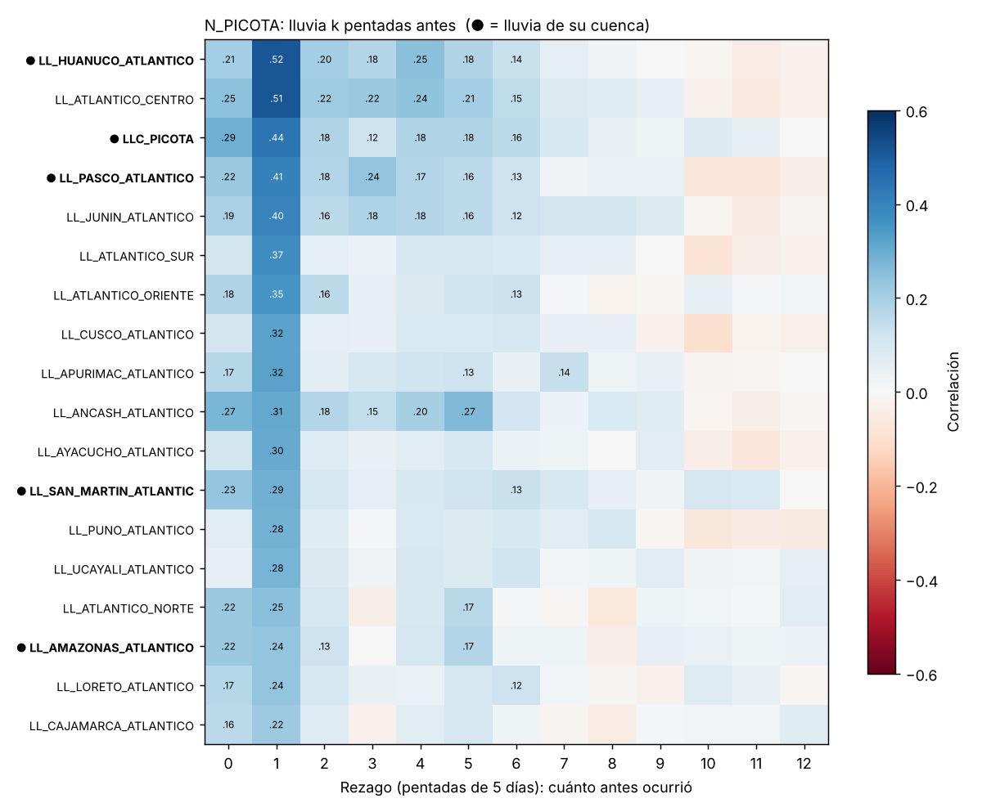
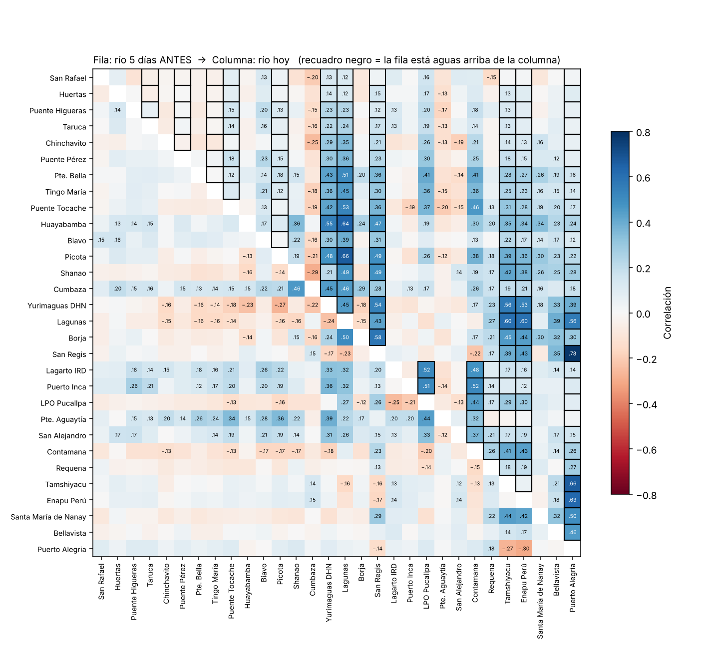
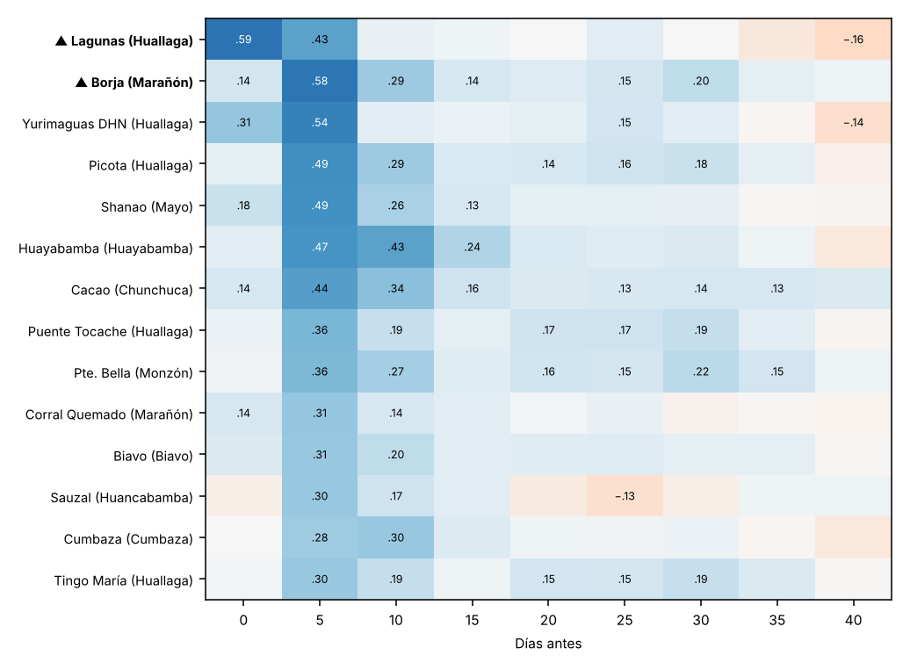
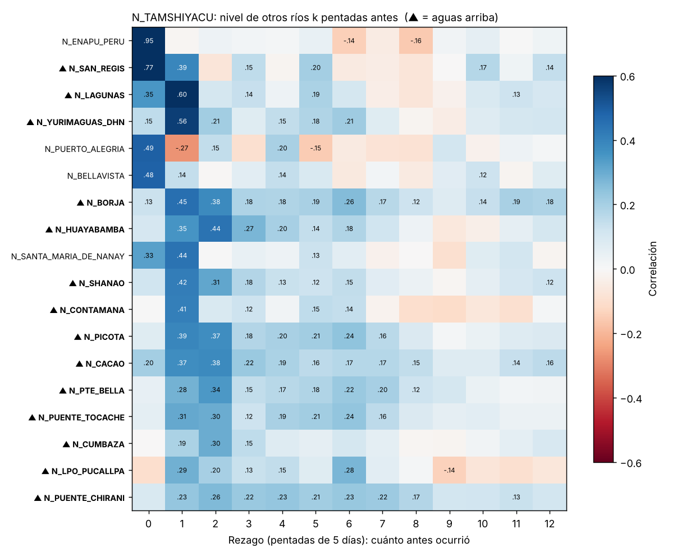

# Resultados · Hidrología del Oriente

Qué determina el nivel de los ríos de Loreto, San Martín y Ucayali: la lluvia (y de qué región) o el nivel de otros ríos.

**Resultados preliminares** con datos de enero de 2023 al 25 de octubre de 2026. Última actualización: 15/11/2026.

---

## Resumen

- En los **ríos grandes** (Amazonas, Marañón bajo, y los tramos medios del Huallaga y del Ucayali), el nivel lo determina sobre todo **lo que traen los ríos de aguas arriba**. La lluvia actúa a través de ellos.
- Donde **no hay estaciones aguas arriba** (Mayo, Huayabamba, Biavo, Pachitea, Aguaytía, Nanay, Napo y otros), lo determina **la lluvia de su propia cuenca**, con una demora típica de 5 a 10 días.
- La lluvia de su cuenca mejora la predicción del nivel en **27 de 30 ríos**. La mejora mediana es de 10 % en los 14 ríos sin estaciones aguas arriba.
- En los 16 ríos que tienen estaciones aguas arriba, sumar esos ríos baja el error de predicción una mediana de **40 %**.
- **La señal va en un solo sentido.** A 5 días, el 73 % de los pares «río de arriba → río de abajo» muestra anticipación; al revés, el 5 %, que es lo esperable por azar.
- **Tiempos de llegada del agua:** menos de 5 días en el Huallaga alto y medio; alrededor de 5 días por tramo desde Yurimaguas hacia abajo; 5 a 10 días de Borja a San Regis en el Marañón.

---

## 1. Datos

| Dato | Fuente | Frecuencia | Cobertura |
|---|---|---|---|
| Nivel de los ríos | SENAMHI, monitoreo hidrológico (`SENAMHI_rios_diario.csv`, del recolector `senamhi_navegador.js`) | Diaria, promediada cada 5 días | Ene-2023 a nov-2026. 30 estaciones del Oriente y 21 de aguas arriba |
| Lluvia | Excel de indicadores de precipitación y SPI pentadal (fuente indicada en el archivo: Senamhi, ANA y Chirps) | 5 días (pentadas) | Ago-1981 a 25-oct-2026. 43 zonas por vertiente; se usan las 20 de la vertiente del Atlántico |

- **Pentada:** P1 = días 1–5, P2 = 6–10, …, P6 = día 26 a fin de mes. Hay 72 por año.
- **Muestra común:** 275 pentadas (2023-01-P1 a 2026-10-P5).
- El Excel trae la lluvia **acumulada dentro del mes**; la de cada pentada sale de restar acumulados consecutivos (hojas ocultas `TRZDR_PenAc` y `TVZDV_PenAc`).
- El Excel de 10 días es la misma información agregada. Coincide exactamente con el de 5 días hasta julio de 2026; de agosto a octubre de 2026 difieren 38 celdas de la selva, que se tratan como **datos provisionales**.

## 2. Procedimiento econométrico

### 2.1 Preparación

1. **Nivel por pentada:** promedio del nivel diario en cada pentada. Se exigen al menos 3 días con dato. Si un día aparece en las series ACTUAL y ANTERIOR del CSV, manda ACTUAL.
2. **Huecos:** se interpolan los de hasta 3 pentadas (15 días). Se descartan las series con más de 30 % de huecos; por eso **Nauta** queda fuera.
3. **Variable de río:** por estación se usa el NIVEL; si no lo tiene, el CAUDAL.

### 2.2 Desestacionalización

Llueve más de noviembre a abril y los ríos crecen en esos mismos meses. Con las series crudas, cualquier lluvia «explica» cualquier río solo por compartir temporada. Por eso se trabaja con **anomalías**:

- **Lluvia:** valor de la pentada menos la media 1991–2020 de esa misma pentada del año.
- **Ríos:** con solo 4 años, el promedio por pentada sería muy ruidoso. Se resta un ciclo anual suave, estimado por mínimos cuadrados:

$$y_t = a + \sum_{k=1}^{2} \left[ b_k \sin\!\left(\tfrac{2\pi k\,p_t}{72}\right) + c_k \cos\!\left(\tfrac{2\pi k\,p_t}{72}\right) \right] + u_t$$

donde $p_t$ es la pentada del año (0 a 71). La anomalía es $\hat u_t$.

### 2.3 Red de ríos

**El agua solo baja.** Cada río solo puede ser explicado por:

- los **ríos de aguas arriba** (los que le mandan agua), y
- la **lluvia de su cuenca**: los departamentos (vertiente del Atlántico) que drenan hacia él, contando los de aguas arriba.

La red se armó con la geografía de cada río y, donde había duda, con el **balance de caudales** de los propios datos. Ejemplo: el caudal medio en Tingo María (438 m³/s) es casi la suma de Puente Pérez (225) y del Monzón en Pte. Bella (199), así que el Monzón entra antes de esa estación. Se sumaron 21 estaciones fuera del Oriente que mandan agua a Loreto: Marañón alto (Cajamarca), Apurímac, Vilcanota y Perené.

Para cada río se construye la **lluvia promedio de su cuenca** (`LLC_…`). Es el promedio de las zonas departamentales de su cuenca, ponderado por el número de estaciones de lluvia de cada zona.

La red completa está en la [sección 5](#5-red-de-ríos-usada).

### 2.4 Correlograma cruzado con preblanqueo

Para cada par (X = lluvia u otro río, Y = río), se mide la correlación entre $X_{t-k}$ e $Y_t$ para $k = 0, 1, \dots, 12$ pentadas (0 a 60 días).

- **Preblanqueo:** se ajusta un AR(p) a X, con p elegido por BIC entre 0 y 6, y el mismo filtro se aplica a X e Y. Sin este paso, la inercia de los ríos infla y alarga las correlaciones.
- **Banda de significancia:** $\pm 2/\sqrt{n} \approx \pm 0{,}12$.

### 2.5 Modelos de predicción

Para cada río $y$ se estiman cuatro modelos:

| Modelo | Variables |
|---|---|
| (a) Inercia | $y_{t-1},\ y_{t-2}$ |
| (b) + lluvia | (a) + lluvia de su cuenca, rezagos 0 a 6 pentadas |
| (c) + anticipar | (b) + ríos de aguas arriba, rezagos 1 a 3 (sirve para **pronosticar**) |
| (d) + explicar | (c) + ríos de aguas arriba de la misma pentada (sirve para **entender qué lo determina**) |

Pasos:

1. **Preselección:** entre los candidatos válidos según la red, se toman las 4 zonas de lluvia y los 4 ríos con mayor correlación cruzada preblanqueada positiva. Solo se usa la parte de los datos destinada a estimar.
2. **Selección de rezagos:** LASSO con validación cruzada temporal (`TimeSeriesSplit`, 4 cortes) sobre las variables estandarizadas. La inercia propia siempre entra.
3. **Estimación:** MCO con las variables elegidas y errores estándar HAC (Newey-West, 6 rezagos).
4. **Evaluación fuera de muestra:** en tres tramos sucesivos. Se estima con el 55 %, 70 % y 85 % inicial y se predice el 15 % siguiente. Se descarta un tramo si quedan menos de 100 pentadas para estimar.
5. **Medida:** mejora del RMSE frente al modelo (a): $100 \times (1 - RMSE_{modelo} / RMSE_{inercia})$. Positivo = la información aporta.

### 2.6 Causalidad de Granger y controles

Se prueba Granger (test F, hasta 6 rezagos) para la mejor lluvia de la cuenca y el mejor río de aguas arriba de cada río, con dos controles:

- **Sentido inverso:** el río de abajo «causando» al de arriba, algo físicamente imposible.
- **Zona placebo:** lluvia de la vertiente del **Pacífico Sur**, que no drena a la Amazonía. Se prueba de a pares y de forma condicional: test de Wald conjunto de sus rezagos 0 a 3 en un modelo que ya incluye la inercia y la lluvia de las cuatro zonas atlánticas.

| Prueba (p < 0,05) | Ríos con resultado significativo |
|---|--:|
| Lluvia de su cuenca | 97 % |
| Río de aguas arriba | 88 % |
| Sentido inverso (debería ser ≈ 5 %) | 75 % |
| Placebo, de a pares (debería ser ≈ 5 %) | 57 % |
| Placebo, condicional (debería ser ≈ 5 %) | 20 % |

**Conclusión metodológica:** la prueba de Granger de a pares **no sirve aquí por sí sola**. Da positivo con el placebo y en el sentido inverso, porque la lluvia de regiones distintas se mueve en parte junta y los ríos responden a ella a la vez. Por eso la dirección se toma de la red, y la evidencia de cuánto aporta cada variable se toma de la **predicción fuera de muestra**.

---

## 3. Resultados por río

Los porcentajes son la reducción del error de predicción fuera de muestra frente al modelo de pura inercia. «Demora de la lluvia» es el rezago de la zona de lluvia de su cuenca con mayor correlación.

| Río | Estación | Qué lo determina sobre todo | R² inercia | Con lluvia | + ríos (anticipar) | + ríos (explicar) | Demora de la lluvia |
|---|---|---|--:|--:|--:|--:|--:|
| Amazonas | Enapu Perú | Ríos de aguas arriba; la lluvia casi no añade | 0,93 | 2 % | 18 % | 70 % | 10 días |
| Amazonas | Puerto Alegria | Ríos de aguas arriba; la lluvia casi no añade | 0,95 | -8 % | 28 % | 38 % | 15 días |
| Amazonas | Tamshiyacu | Ríos de aguas arriba; la lluvia casi no añade | 0,92 | -3 % | 8 % | 15 % | 10 días |
| Marañón | San Regis | Ríos de aguas arriba; la lluvia casi no añade | 0,82 | 0 % | 6 % | 14 % | 10 días |
| Marañón | Borja | Lluvia de su cuenca; los ríos añaden poco | 0,38 | 11 % | 10 % | 11 % | 5 días |
| Huallaga | Tingo María | Ríos de aguas arriba y lluvia de su cuenca | 0,49 | 19 % | 15 % | 66 % | 5 días |
| Huallaga | Picota | Ríos de aguas arriba y lluvia de su cuenca | 0,41 | 16 % | 19 % | 65 % | 5 días |
| Huallaga | Taruca | Ríos de aguas arriba y lluvia de su cuenca | 0,53 | 23 % | 16 % | 59 % | 5 días |
| Huallaga | Puente Tocache | Ríos de aguas arriba y lluvia de su cuenca | 0,47 | 24 % | 23 % | 50 % | 5 días |
| Huallaga | Yurimaguas DHN | Ríos de aguas arriba y lluvia de su cuenca | 0,59 | 18 % | 28 % | 44 % | 5 días |
| Huallaga | Lagunas | Ríos de aguas arriba y lluvia de su cuenca | 0,71 | 14 % | 31 % | 42 % | 10 días |
| Huallaga | Puente Pérez | Ríos de aguas arriba y lluvia de su cuenca | 0,46 | 19 % | 13 % | 37 % | 5 días |
| Huallaga | San Rafael | Lluvia de su cuenca (sin estaciones aguas arriba) | 0,74 | 12 % | — | — | 5 días |
| Ucayali | Contamana | Ríos de aguas arriba y lluvia de su cuenca | 0,84 | 5 % | 13 % | 48 % | 10 días |
| Ucayali | Lagarto IRD | Ríos de aguas arriba y lluvia de su cuenca | 0,35 | 19 % | 15 % | 37 % | 5 días |
| Ucayali | LPO Pucallpa | Ríos de aguas arriba y lluvia de su cuenca | 0,75 | 6 % | 4 % | 16 % | 5 días |
| Ucayali | Requena | Su propia inercia | 0,98 | 4 % | 5 % | 3 % | 20 días |
| Aguaytía | Pte. Aguaytía | Lluvia de su cuenca (sin estaciones aguas arriba) | 0,29 | 20 % | — | — | < 5 días |
| Biavo | Biavo | Lluvia de su cuenca (sin estaciones aguas arriba) | 0,45 | 9 % | — | — | 5 días |
| Chinchao | Chinchavito | Lluvia de su cuenca (sin estaciones aguas arriba) | 0,67 | 8 % | — | — | 5 días |
| Cumbaza | Cumbaza | Lluvia de su cuenca (sin estaciones aguas arriba) | 0,41 | 16 % | — | — | < 5 días |
| Higueras | Puente Higueras | Lluvia de su cuenca (sin estaciones aguas arriba) | 0,66 | 10 % | — | — | 5 días |
| Huayabamba | Huayabamba | Lluvia de su cuenca (sin estaciones aguas arriba) | 0,30 | 10 % | — | — | < 5 días |
| Huertas | Huertas | Lluvia de su cuenca (sin estaciones aguas arriba) | 0,68 | 9 % | — | — | 5 días |
| Mayo | Shanao | Lluvia de su cuenca (sin estaciones aguas arriba) | 0,51 | 20 % | — | — | 5 días |
| Monzón | Pte. Bella | Lluvia de su cuenca (sin estaciones aguas arriba) | 0,48 | 9 % | — | — | 5 días |
| Nanay | Santa María de Nanay | Lluvia de su cuenca (sin estaciones aguas arriba) | 0,79 | 8 % | — | — | 10 días |
| Napo | Bellavista | Lluvia de su cuenca (sin estaciones aguas arriba) | 0,86 | 7 % | — | — | 15 días |
| Pachitea | Puerto Inca | Lluvia de su cuenca (sin estaciones aguas arriba) | 0,25 | 18 % | — | — | 5 días |
| San Alejandro | San Alejandro | Lluvia de su cuenca (sin estaciones aguas arriba) | 0,13 | 15 % | — | — | < 5 días |

**Lectura:**

- **Amazonas y Marañón en San Regis:** la lluvia casi no mejora la predicción por sí sola, pero los ríos de aguas arriba sí. Por cada metro que sube el Marañón en San Regis, el Amazonas en Tamshiyacu sube unos 60 cm en la misma pentada.
- **Huallaga y Ucayali, tramos medios:** pesan las dos cosas.
- **Requena** tiene 23 % de huecos y es el resultado menos confiable. **Lagarto** solo pudo evaluarse en un tramo.

*Huallaga en Picota: correlación con la lluvia de cada zona, k pentadas antes. «●» = zonas de su cuenca. La señal más fuerte es la lluvia de Huánuco, 5 días antes.*

---

## 4. Correlogramas entre ríos

### 4.1 Cada conexión directa

Una fila por cada par de estaciones vecinas en la red. En **negrita**, las correlaciones positivas que superan la banda de significancia. «Al revés» es el río de abajo, 5 días antes, contra el de arriba: debería ser cercano a cero.

**Huallaga**

| De (aguas arriba) | A (aguas abajo) | Misma pentada | 5 días antes | 10 días antes | 15 días antes | Tiempo de llegada | Al revés, 5 días |
|---|---|--:|--:|--:|--:|---|--:|
| Puente Higueras (Higueras) | Taruca | **0,89** | 0,07 | -0,13 | -0,05 | < 5 días | 0,01 |
| San Rafael (Huallaga) | Taruca | **0,77** | -0,05 | -0,10 | -0,02 | < 5 días | 0,00 |
| Huertas (Huertas) | Taruca | **0,69** | -0,05 | -0,10 | 0,12 | < 5 días | 0,11 |
| Taruca (Huallaga) | Puente Pérez | **0,69** | 0,02 | -0,10 | 0,12 | < 5 días | 0,06 |
| Chinchavito (Chinchao) | Puente Pérez | **0,61** | -0,04 | -0,09 | 0,04 | < 5 días | 0,02 |
| Pte. Bella (Monzón) | Tingo María | **0,88** | 0,01 | -0,10 | **0,17** | < 5 días | -0,06 |
| Puente Pérez (Huallaga) | Tingo María | **0,83** | 0,03 | -0,10 | **0,16** | < 5 días | 0,01 |
| Tingo María (Huallaga) | Puente Tocache | **0,83** | 0,12 | -0,14 | **0,15** | < 5 días | -0,06 |
| Huayabamba (Huayabamba) | Picota | **0,84** | 0,11 | 0,00 | 0,03 | < 5 días | -0,13 |
| Puente Tocache (Huallaga) | Picota | **0,81** | 0,03 | -0,10 | **0,15** | < 5 días | 0,00 |
| Biavo (Biavo) | Picota | **0,55** | 0,02 | -0,04 | 0,12 | < 5 días | 0,09 |
| Picota (Huallaga) | Yurimaguas DHN | **0,57** | **0,48** | -0,03 | 0,10 | ≈ 5 días | -0,27 |
| Shanao (Mayo) | Yurimaguas DHN | **0,54** | **0,21** | 0,05 | 0,02 | < 5 días | -0,07 |
| Cumbaza (Cumbaza) | Yurimaguas DHN | **0,22** | **0,45** | 0,09 | -0,02 | 5 a 10 días | -0,22 |
| Yurimaguas DHN (Huallaga) | Lagunas | **0,69** | **0,45** | -0,08 | 0,06 | ≈ 5 días | -0,24 |

**Marañón**

| De (aguas arriba) | A (aguas abajo) | Misma pentada | 5 días antes | 10 días antes | 15 días antes | Tiempo de llegada | Al revés, 5 días |
|---|---|--:|--:|--:|--:|---|--:|
| Cacao (Chunchuca) | Borja | **0,57** | **0,14** | -0,02 | 0,06 | < 5 días | -0,06 |
| Sauzal (Huancabamba) | Borja | **0,47** | 0,03 | -0,02 | -0,07 | < 5 días | 0,04 |
| Corral Quemado (Marañón) | Borja | **0,45** | -0,01 | -0,07 | 0,03 | < 5 días | 0,14 |
| Chotano Lajas (Chotano) | Borja | **0,28** | **0,15** | -0,06 | -0,05 | < 5 días | 0,10 |
| Maygasbamba (Maygasbamba) | Borja | **0,27** | **0,13** | -0,16 | 0,03 | < 5 días | 0,10 |
| Llaucano Corellama (Llaucano) | Borja | **0,26** | **0,20** | -0,05 | 0,02 | < 5 días | 0,00 |
| Lagunas (Huallaga) | San Regis | **0,59** | **0,43** | 0,06 | 0,03 | ≈ 5 días | -0,23 |
| Borja (Marañón) | San Regis | **0,14** | **0,58** | **0,29** | **0,14** | 5 a 10 días | -0,05 |

**Ucayali**

| De (aguas arriba) | A (aguas abajo) | Misma pentada | 5 días antes | 10 días antes | 15 días antes | Tiempo de llegada | Al revés, 5 días |
|---|---|--:|--:|--:|--:|---|--:|
| Puente Chirani (Perene) | Lagarto IRD | **0,52** | **0,15** | -0,08 | -0,01 | < 5 días | 0,17 |
| Intihuatana km 105 (Vilcanota) | Lagarto IRD | **0,39** | 0,05 | -0,03 | -0,05 | < 5 días | 0,19 |
| Paucartambo (Mapacho) | Lagarto IRD | **0,34** | **0,15** | -0,03 | -0,06 | < 5 días | 0,14 |
| Puente Cunyac (Apurímac) | Lagarto IRD | **0,33** | **0,16** | 0,02 | -0,03 | < 5 días | 0,13 |
| Puente Pampas (Pampas) | Lagarto IRD | **0,26** | **0,22** | -0,15 | -0,21 | < 5 días | 0,01 |
| Santa Rosa Chapimarca (Pachachaca) | Lagarto IRD | **0,22** | **0,22** | -0,05 | -0,10 | 5 a 10 días | 0,05 |
| Lagarto IRD (Ucayali) | LPO Pucallpa | **0,33** | **0,52** | **0,15** | 0,10 | ≈ 5 días | -0,25 |
| Puerto Inca (Pachitea) | LPO Pucallpa | **0,35** | **0,51** | 0,10 | 0,09 | ≈ 5 días | -0,21 |
| LPO Pucallpa (Ucayali) | Contamana | **0,73** | **0,44** | -0,02 | 0,09 | ≈ 5 días | -0,20 |
| San Alejandro (San Alejandro) | Contamana | **0,21** | **0,37** | **0,24** | **0,19** | 5 a 10 días | -0,08 |
| Pte. Aguaytía (Aguaytía) | Contamana | -0,05 | **0,32** | **0,19** | 0,07 | 5 a 10 días | 0,05 |
| Contamana (Ucayali) | Requena | **0,22** | **0,26** | **0,24** | **0,17** | 5 a 10 días | -0,15 |

**Amazonas**

| De (aguas arriba) | A (aguas abajo) | Misma pentada | 5 días antes | 10 días antes | 15 días antes | Tiempo de llegada | Al revés, 5 días |
|---|---|--:|--:|--:|--:|---|--:|
| San Regis (Marañón) | Tamshiyacu | **0,77** | **0,39** | -0,07 | **0,15** | ≈ 5 días | -0,16 |
| Requena (Ucayali) | Tamshiyacu | 0,09 | **0,18** | -0,03 | 0,03 | Relación débil | 0,13 |
| Tamshiyacu (Amazonas) | Enapu Perú | **0,95** | 0,05 | -0,03 | -0,03 | < 5 días | -0,01 |
| Enapu Perú (Amazonas) | Puerto Alegria | **0,67** | **0,63** | 0,01 | 0,03 | ≈ 5 días | -0,30 |
| Santa María de Nanay (Nanay) | Puerto Alegria | **0,23** | **0,50** | **0,23** | 0,09 | 5 a 10 días | 0,01 |
| Bellavista (Napo) | Puerto Alegria | **0,44** | **0,46** | 0,06 | 0,05 | ≈ 5 días | -0,02 |

**Lectura:**

- **Huallaga, de San Rafael a Picota:** todo se transmite en la misma pentada (0,55 a 0,89). Es un río de respuesta rápida.
- **De Picota a Yurimaguas y Lagunas:** aparece la demora, repartida entre la misma pentada y 5 días después.
- **Marañón:** de Borja a San Regis el agua tarda 5 a 10 días. El Huallaga, por Lagunas, llega antes.
- **Ucayali:** Lagarto y el Pachitea anticipan a Pucallpa unos 5 días. El Aguaytía y el San Alejandro tardan 5 a 10 días en notarse en Contamana.
- **Amazonas:** Tamshiyacu e Iquitos (Enapu) son casi el mismo nivel (0,95).
- **Borja** se relaciona solo moderadamente con el Marañón alto. Probablemente es porque entre Corral Quemado y Borja entran afluentes grandes sin estación en estos datos (Chinchipe, Utcubamba, Santiago).

### 4.2 Todos contra todos, a 5 días

*Fila: río 5 días antes. Columna: río hoy. Los ríos están ordenados de aguas arriba hacia aguas abajo, y el recuadro negro indica que la fila está aguas arriba de la columna. El azul se concentra arriba de la diagonal: los de arriba anticipan a los de abajo y no al revés. Correlación mediana entre pares conectados: arriba → abajo 0,19; abajo → arriba 0,01.*

El azul fuera de los recuadros (por ejemplo, el Huallaga «anticipando» a Contamana, en el Ucayali) no es agua que se transmita: lo más probable es que sea lluvia compartida. Por eso la correlación sola no basta y se usa la red.

### 4.3 Ejemplos

*Marañón en San Regis: estaciones de aguas arriba (▲ = vecinas directas) y días de anticipación.*

*Amazonas en Tamshiyacu: «▲» = ríos de aguas arriba. Enapu, Puerto Alegría, Napo y Nanay no llevan marca: están aguas abajo o en otro río, y se mueven juntos sin mandarle agua.*

---

## 5. Red de ríos usada

| Río | Estación | Su agua llega a | Recibe agua directa de | Lluvia de su cuenca (departamentos, vertiente del Atlántico) | Serie |
|---|---|---|---|---|---|
| Amazonas | Puerto Alegria | (última estación) | Enapu Perú, Santa María de Nanay, Bellavista | Loreto, San Martín, Huánuco, Pasco, Amazonas, Ancash, La Libertad, Cajamarca, Piura, Lambayeque, Ucayali, Junín, Huancavelica, Ayacucho, Apurímac, Cusco, Arequipa | `LLC_PUERTO_ALEGRIA` |
| Amazonas | Enapu Perú | Puerto Alegria | Tamshiyacu | Loreto, San Martín, Huánuco, Pasco, Amazonas, Ancash, La Libertad, Cajamarca, Piura, Lambayeque, Ucayali, Junín, Huancavelica, Ayacucho, Apurímac, Cusco, Arequipa | `LLC_ENAPU_PERU` |
| Amazonas | Tamshiyacu | Enapu Perú | San Regis, Requena | Loreto, San Martín, Huánuco, Pasco, Amazonas, Ancash, La Libertad, Cajamarca, Piura, Lambayeque, Ucayali, Junín, Huancavelica, Ayacucho, Apurímac, Cusco, Arequipa | `LLC_TAMSHIYACU` |
| Marañón | San Regis | Tamshiyacu | Lagunas, Borja | Loreto, San Martín, Huánuco, Pasco, Amazonas, Ancash, La Libertad, Cajamarca, Piura, Lambayeque | `LLC_SAN_REGIS` |
| Marañón | Borja | San Regis | Corral Quemado, Llaucano Corellama, Maygasbamba, Chotano Lajas, Sauzal, Cacao | Ancash, Huánuco, La Libertad, Cajamarca, Amazonas, Piura, Lambayeque | `LLC_BORJA` |
| Huallaga | San Rafael | Taruca | — | Pasco, Huánuco | `LLC_SAN_RAFAEL` |
| Huallaga | Yurimaguas DHN | Lagunas | Picota, Shanao, Cumbaza | San Martín, Loreto, Huánuco, Pasco, Amazonas | `LLC_YURIMAGUAS_DHN` |
| Huallaga | Lagunas | San Regis | Yurimaguas DHN | Loreto, San Martín, Huánuco, Pasco, Amazonas | `LLC_LAGUNAS` |
| Huallaga | Picota | Yurimaguas DHN | Puente Tocache, Huayabamba, Biavo | San Martín, Huánuco, Pasco, Amazonas | `LLC_PICOTA` |
| Huallaga | Tingo María | Puente Tocache | Puente Pérez, Pte. Bella | Huánuco, Pasco | `LLC_TINGO_MARIA` |
| Huallaga | Taruca | Puente Pérez | San Rafael, Huertas, Puente Higueras | Huánuco, Pasco | `LLC_TARUCA` |
| Huallaga | Puente Pérez | Tingo María | Taruca, Chinchavito | Huánuco, Pasco | `LLC_PUENTE_PEREZ` |
| Huallaga | Puente Tocache | Picota | Tingo María | Huánuco, San Martín, Pasco | `LLC_PUENTE_TOCACHE` |
| Ucayali | LPO Pucallpa | Contamana | Lagarto IRD, Puerto Inca | Ucayali, Huánuco, Junín, Pasco, Huancavelica, Ayacucho, Apurímac, Cusco, Arequipa | `LLC_LPO_PUCALLPA` |
| Ucayali | Requena | Tamshiyacu | Contamana | Loreto, Ucayali, Huánuco, Junín, Pasco, Huancavelica, Ayacucho, Apurímac, Cusco, Arequipa | `LLC_REQUENA` |
| Ucayali | Contamana | Requena | LPO Pucallpa, Pte. Aguaytía, San Alejandro | Ucayali, Loreto, Huánuco, Junín, Pasco, Huancavelica, Ayacucho, Apurímac, Cusco, Arequipa | `LLC_CONTAMANA` |
| Ucayali | Lagarto IRD | LPO Pucallpa | Puente Chirani, Puente Cunyac, Puente Pampas, Santa Rosa Chapimarca, Intihuatana km 105, Paucartambo | Junín, Pasco, Huancavelica, Ayacucho, Apurímac, Cusco, Arequipa | `LLC_LAGARTO_IRD` |
| Aguaytía | Pte. Aguaytía | Contamana | — | Ucayali, Huánuco | `LLC_PTE_AGUAYTIA` |
| Biavo | Biavo | Picota | — | San Martín | `LLC_BIAVO` |
| Chinchao | Chinchavito | Puente Pérez | — | Huánuco | `LLC_CHINCHAVITO` |
| Cumbaza | Cumbaza | Yurimaguas DHN | — | San Martín | `LLC_CUMBAZA` |
| Higueras | Puente Higueras | Taruca | — | Huánuco | `LLC_PUENTE_HIGUERAS` |
| Huayabamba | Huayabamba | Picota | — | San Martín, Amazonas | `LLC_HUAYABAMBA` |
| Huertas | Huertas | Taruca | — | Pasco, Huánuco | `LLC_HUERTAS` |
| Mayo | Shanao | Yurimaguas DHN | — | San Martín, Amazonas | `LLC_SHANAO` |
| Monzón | Pte. Bella | Tingo María | — | Huánuco | `LLC_PTE_BELLA` |
| Nanay | Santa María de Nanay | Puerto Alegria | — | Loreto | `LLC_SANTA_MARIA_DE_NAN` |
| Napo | Bellavista | Puerto Alegria | — | Loreto | `LLC_BELLAVISTA` |
| Pachitea | Puerto Inca | LPO Pucallpa | — | Pasco, Huánuco | `LLC_PUERTO_INCA` |
| San Alejandro | San Alejandro | Contamana | — | Ucayali, Huánuco | `LLC_SAN_ALEJANDRO` |

**Supuestos por confirmar con alguien que conozca la zona:**

- **Enapu Perú (Iquitos):** se asumió que está aguas arriba de la boca del Nanay; por eso el Nanay solo alimenta a Puerto Alegría.
- **Tributarios del Marañón alto** (Chotano, Huancabamba, Chunchuca, Llaucano): se conectaron directo a Borja, sin fijar si entran antes o después de Corral Quemado. No cambia los resultados del Oriente.
- **Fuera de la red:** los ríos del Pacífico y del Titicaca, el Inambari (va al Madre de Dios), y Pallanga, Rumichaca y Cañad, cuya cuenca no se pudo confirmar.

---

## 6. Limitaciones

- **Son cuatro años de ríos (275 pentadas).** Alcanza para tiempos de respuesta típicos, no para crecidas o estiajes extremos. Los resultados mejorarán al sumar años y la información mensual anterior a 2020.
- **La resolución es de 5 días.** «Menos de 5 días» no distingue entre horas y cuatro días. Para afinar, habría que repetir el análisis con datos diarios.
- **La lluvia de ago–oct 2026 es provisional**, sobre todo en la selva.
- **Pocas estaciones de lluvia en algunas zonas:** Ucayali tiene 4, Pasco 3 y Arequipa 1.
- **La lluvia cubre solo el Perú.** El Napo nace en Ecuador y parte de la cuenca del Marañón está allí; esa lluvia no figura.
- **La lluvia por departamento aproxima la lluvia de cada cuenca**, pero los límites no coinciden.
- **Es relación predictiva, no prueba física.** La dirección la fija la red, que es un supuesto.

---

## 7. Cómo reproducirlo

El análisis corre en un cuaderno de Google Colab (`Lluvias_y_Rios_Oriente.ipynb`) que lee de Google Drive los dos archivos de entrada:

1. El Excel de lluvias de 5 días.
2. `SENAMHI_rios_diario.csv`, que se descarga en la página: Hidrología → «Descargar datos».

Los pasos dentro del cuaderno son: preparación, red de ríos (editable), correlogramas, modelos y pruebas. Escribe en Drive `panel_oriente.xlsx` (datos listos para EViews), `resultados.xlsx` y los mapas.

Hay además una guía paso a paso para **EViews 12** (`Guia_EViews12_lluvias_y_rios.pdf`) y un programa (`lluvias_rios.prg`) que repiten las estimaciones principales.

El cuaderno, los datos y los resultados completos **no están en este repositorio**, porque el repositorio es público. Están en la carpeta de Drive del proyecto.

**Librerías:** pandas, numpy, statsmodels (MCO con HAC, Granger, AR por BIC), scikit-learn (`LassoCV`, `TimeSeriesSplit`), openpyxl y matplotlib.
